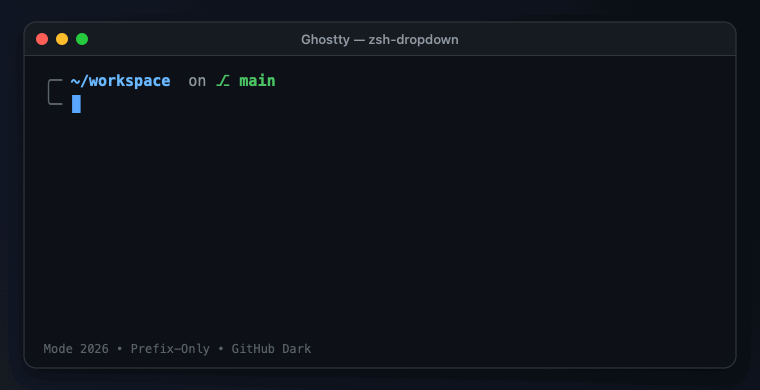

# zsh-dropdown

[](https://github.com/ga2631/zsh-dropdown/actions/workflows/ci.yml)
[](LICENSE)

A fast, flicker-free, themed **live completion dropdown** plugin for **Zsh / Oh My Zsh** — built on top of [`zsh-autocomplete`](https://github.com/marlonrichert/zsh-autocomplete) and crafted for modern GPU terminals (**Ghostty, Kitty, WezTerm, iTerm2, Alacritty**).

<p align="center">
  
</p>

Start typing and matching folders, files, commands, or git branches appear live below your prompt and narrow on every keystroke — with **zero cursor jumping** and clean IDE-style highlighting.

---

## Why `zsh-dropdown`?

Out of the box, pairing `zsh-autocomplete` with Oh My Zsh and modern terminals hits four common UX rough edges:

1. **Cursor jumping while typing** — rapid dropdown redraws visibly flash the cursor to column 0 and back between keystrokes.
2. **Noisy mid-word fuzzy matches** — typing `cd a` lists unrelated folders containing `a` in the middle instead of folders starting with `a`.
3. **Zsh 5.9 `zasync` silent autoload failure** — `zsh-autocomplete`'s async worker can silently fail to initialize when `~/.cache/zsh/zasync` isn't on `fpath`, preventing the live dropdown from ever appearing.
4. **`fzf --zsh` hijacking `Tab`** — sourcing `fzf --zsh` later in `.zshrc` overwrites `Tab` (`^I`), breaking interactive dropdown selection.

`zsh-dropdown` solves all four automatically and ships curated true-color themes (**GitHub Dark**, **Catppuccin Mocha**, **Tokyo Night**).

---

## How It Works

`zsh-dropdown` layers cleanly on top of `zsh-autocomplete` without patching or forking it, using a 4-stage lifecycle:

```text
1. Plugin load (.zshrc)
   ├── Adds ~/.cache/zsh/zasync to fpath (prevents Zsh 5.9 autoload stall)
   ├── Sets strict prefix-only completion zstyles (cd a -> a*, cd ab -> ab*)
   └── Applies true-color list-colors & section headers (── directory ──)

2. First prompt (deferred precmd hook, right after zsh-autocomplete init)
   ├── Self-heals zasync if an undefined pathless autoload stub exists
   ├── Wraps .autocomplete:async:complete:callback in DEC Mode 2026
   └── Restores Tab (^I) -> menu-select while leaving Ctrl+R / Ctrl+T on fzf

3. Every keystroke (live typing)
   ├── Keystroke -> zsh-autocomplete fetches matches asynchronously (50ms)
   ├── Sends \e[?2026h (Begin Synchronized Update) to /dev/tty
   ├── ZLE draws dropdown below prompt and returns cursor to end of line
   └── Sends \e[?2026l (End Synchronized Update) in an `always` block
       └─> Terminal paints the entire dropdown + cursor in 1 atomic GPU frame!
```

### Key Technical Details

* **Zero-Flicker Redraws (DEC Mode 2026)**: When Zsh draws a completion list below the prompt, ZLE moves the cursor down, prints the matches, returns to column 0 (`\r`), and jumps back to the end of your input. Without synchronized output, fast terminals render intermediate frames where you see the cursor jump. Wrapping the callback in `\e[?2026h` … `\e[?2026l` (inside a Zsh `always` block so the screen can never stay frozen even on `Ctrl+C`) tells Ghostty/Kitty/WezTerm/iTerm2/Alacritty to buffer the frame and paint everything atomically.
* **Prefix-Only Live Filtering**: By configuring `completer _expand _complete _prefix _ignored` and `matcher-list 'm:{[:lower:]}={[:upper:]}'`, typing lowercase `cd pr` matches `Projects/` and `prisma/` strictly by prefix (never mid-word substrings), while uppercase `cd Pr` matches case-sensitively.
* **Zsh 5.9 `zasync` Self-Healing**: In Zsh 5.9, `autoload -Uz +X zasync` creates an undefined function stub when `zasync` is missing from `fpath`, causing a subsequent `autoload -Uz /path/to/zasync` to silently ignore the path. `zsh-dropdown` both prepends `zasync` to `fpath` early and detects/repairs any pathless autoload stub on the first `precmd`.
* **Graceful Fallback**: On legacy terminals that don't support Mode 2026 (e.g. `TERM=dumb` or basic terminals), `ZSH_DROPDOWN_SYNC_REDRAW=auto` automatically skips emitting `\e[?2026h`/`\e[?2026l`.

---

## Requirements

* Zsh `5.8+`
* [`marlonrichert/zsh-autocomplete`](https://github.com/marlonrichert/zsh-autocomplete)

---

## Installation

### Oh My Zsh

1. Clone both `zsh-autocomplete` (if not already installed) and `zsh-dropdown`:

```bash
git clone --depth=1 https://github.com/marlonrichert/zsh-autocomplete.git \
  "${ZSH_CUSTOM:-$HOME/.oh-my-zsh/custom}/plugins/zsh-autocomplete"

git clone --depth=1 https://github.com/ga2631/zsh-dropdown.git \
  "${ZSH_CUSTOM:-$HOME/.oh-my-zsh/custom}/plugins/zsh-dropdown"
```

2. Add `zsh-dropdown` **after** `zsh-autocomplete` in your `~/.zshrc`:

```zsh
plugins=(
  git
  zsh-autosuggestions
  fast-syntax-highlighting
  zsh-autocomplete
  zsh-dropdown
)
```

3. Restart your shell:

```bash
exec zsh
```

### Zinit

```zsh
zinit light marlonrichert/zsh-autocomplete
zinit light ga2631/zsh-dropdown
```

### Antidote

```text
marlonrichert/zsh-autocomplete
ga2631/zsh-dropdown
```

### Manual

```zsh
source /path/to/zsh-autocomplete/zsh-autocomplete.plugin.zsh
source /path/to/zsh-dropdown/zsh-dropdown.plugin.zsh
```

---

## Configuration

Set any of these variables in `~/.zshrc` **before** sourcing Oh My Zsh (or the plugin):

| Variable | Default | Options / Description |
| :--- | :--- | :--- |
| `ZSH_DROPDOWN_THEME` | `github-dark` | `github-dark`, `catppuccin`, `tokyonight`, or `none` (keep your own `list-colors`) |
| `ZSH_DROPDOWN_MODE` | `prefix` | `prefix` (strict starts-with filtering) or `fuzzy` (default `zsh-autocomplete` matching) |
| `ZSH_DROPDOWN_MIN_INPUT` | `1` | Minimum characters typed before showing the live dropdown |
| `ZSH_DROPDOWN_DELAY` | `0.05` | Delay in seconds after last keystroke before refreshing |
| `ZSH_DROPDOWN_LIST_LINES` | `10` | Maximum height of the dropdown in terminal lines |
| `ZSH_DROPDOWN_SYNC_REDRAW` | `auto` | `auto` (Mode 2026 on Ghostty/Kitty/WezTerm/iTerm2/Alacritty/Foot), `always`, or `never` |
| `ZSH_DROPDOWN_TAB_WIDGET` | `menu-select` | `menu-select`, `complete-word`, or `none` (don't touch `Tab`) |

### Example Custom Config

```zsh
export ZSH_DROPDOWN_THEME="catppuccin"
export ZSH_DROPDOWN_LIST_LINES=12
export ZSH_DROPDOWN_DELAY=0.05

plugins=(git zsh-autosuggestions fast-syntax-highlighting zsh-autocomplete zsh-dropdown)
source $ZSH/oh-my-zsh.sh
```

---

## Usage

* Type any command + prefix (e.g. `cd pr`, `ls con`, `nvim src/`, `git checkout fe`) — matching items appear live below your prompt and filter as you type.
* Press **`Tab`** (or **`↓`**) to enter the highlighted selection bar, move with arrow keys, and press **`Enter`** to confirm.

---

## Terminal Compatibility

| Terminal | 24-bit True Color | Mode 2026 Zero-Flicker | Notes |
| :--- | :---: | :---: | :--- |
| **Ghostty / Kitty / WezTerm / Alacritty / Foot / Rio / Contour** | Yes | Auto | Full native support |
| **iTerm2 / VS Code Terminal / Windows Terminal / Warp / Tabby / Hyper** | Yes | Auto | Full native support |
| **Konsole (`>= 23.08`) & GNOME Terminal / VTE (`>= 0.76`)** | Yes | Auto | Automatically detected |
| **macOS Terminal.app** (`Apple_Terminal`) | 256-color fallback | Skipped | Automatically switches themes to 256-color palette |
| **`tmux` / GNU `screen`** | Depends on config | Guarded | Safely skipped in `auto` mode (`ZSH_DROPDOWN_SYNC_REDRAW=always` to force) |

## Performance

* **~6 ms** shell startup load time; one-time init hook removes itself after prompt #1 (**0 ms** on every subsequent prompt)
* **Faster than default `zsh-autocomplete`** in `prefix` mode by skipping expensive fuzzy/edit-distance completer passes
* **Zero per-redraw `/dev/tty` open/close syscalls** via a persistent `O_CLOEXEC` `sysopen` file descriptor for Mode 2026 atomic GPU frames
* **Safe inside `tmux`** — automatically skips Mode 2026 in `auto` mode when `$TMUX` is set

## Development & Tests

```bash
cc -Wall -Wextra -Werror -std=c11 -O2 -o tests/test_plugin tests/test_plugin.c
./tests/test_plugin
```

## Companion Plugin

Pair `zsh-dropdown` with [**`zsh-editor-keys`**](https://github.com/ga2631/zsh-editor-keys) — bring VS Code / modern GUI text-editing (`Shift+Arrows`, smart subword stops, OS clipboard `Cmd+C/X/V`, `Alt+A` Select All, `Alt+Z` Undo/Redo, and `Shift+Enter` newlines) to your Zsh prompt with 0ms typing overhead.

## License

[MIT](LICENSE)
